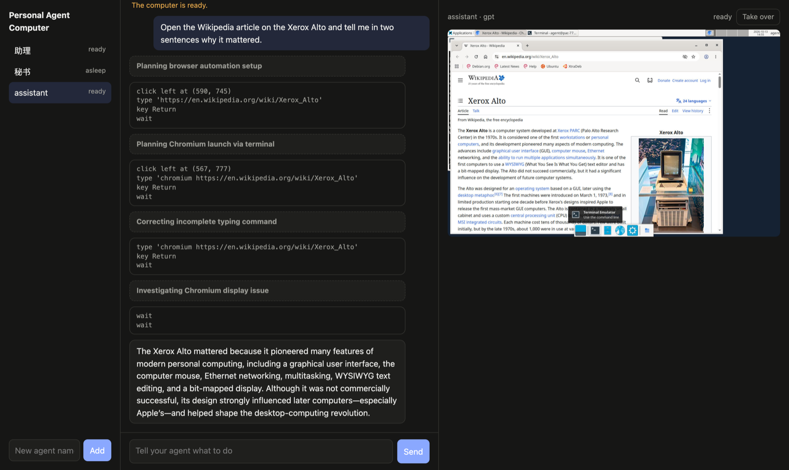

# Personal Agent Computer

A self-hostable computer for your AI agent. Every agent gets its own Linux
desktop virtual machine. You talk to it from a web chat page, watch its screen,
and take over the mouse and keyboard when you need to.

> Status: early. v1 runs end to end on one Incus host; expect rough edges.
> Personal Agent Computer is an independent open-source product, maintained by Softopia.
> The taoz platform is a separate product.



## Quick start

On an Ubuntu 24.04 host with [Incus](https://linuxcontainers.org/incus/) and KVM:

```bash
git clone https://github.com/vesten-ai/personal-agent-computer.git
cd personal-agent-computer
sudo ./install.sh                     # about five minutes the first time
```

Put a model key in the gateway (the installer prints how), then either open the page through an SSH
tunnel or use the terminal:

```bash
pac create assistant
pac send assistant "Open Wikipedia and tell me who designed the first personal computer"
```

The full guide, including credentials and connectors, is in [docs/install.md](docs/install.md).

## How it fits together

```
  browser / pac CLI ──► gateway (outside the VMs) ──► model APIs
                           │  agent loop                (OpenAI Responses,
                           │  web chat, live screen      Anthropic Messages)
                           │  MCP connectors
                           │  egress proxy: swaps placeholder credentials for real ones
                           ▼
                      Incus desktop VM, one per agent
                        XFCE, Chromium, LibreOffice, CJK input, dev tools
                        computer-use daemon (screenshots, mouse, keyboard)
                        holds placeholders only, never real credentials
```

- **The agent loop runs in the gateway, not in the VM.** The VM is the agent's
  computer: a place to click, type, browse and run programs. If the VM is
  compromised or wiped, the conversation and the keys are not in it.
- **One VM per agent.** Incus runs each desktop as a full virtual machine with
  its own kernel, so agents are isolated from each other and from the host.
- **Credentials are swapped in at egress.** Programs inside the VM see
  placeholder tokens. The gateway's egress proxy replaces them with the real
  secret on the way out, for the destinations each secret is allowed to reach.
- **Two model APIs.** The OpenAI Responses API and the Anthropic Messages API.
- **Connectors over MCP.** Connectors are MCP servers the gateway runs outside
  the VMs, so their credentials never reach an agent's computer. v1 ships the
  interface and one example.
- **Sleep and approvals.** Idle computers pause, then shut down, and wake on the
  next message. Before paying, sending or deleting, the agent asks you.

## What v1 does and doesn't do

- A plain web chat page and a `pac` command line.
- One desktop VM per agent on a single Incus host.
- Watching and taking over the agent's screen from the browser.
- No messaging-app integrations, no bundled connectors, no multi-user accounts: one admin token.
- Tested live with Claude Opus 5.5 (Anthropic's computer toolset) and with GPT through an
  OpenAI-compatible relay (computer use as a function tool).
- Known gaps: DNS lookups are logged and rate-limited but can still leak small amounts of data,
  and OpenAI's built-in computer tool has only been tested offline.

## Repository layout

| Path | What |
|------|------|
| `install.sh` | One-shot installer for an Incus host ([docs/install.md](docs/install.md)) |
| `gateway/` | The gateway: agent loop, model adapters, web page, connectors, egress proxy addon |
| `image/` | Builds the desktop image and the computer-use daemon that runs inside it |
| `host/` | Host network and Incus setup |
| `spikes/` | The experiments that settled the design, with their findings |
| `docs/` | Install guide and design notes |

## Contributing and security

See [CONTRIBUTING.md](CONTRIBUTING.md). Please report vulnerabilities privately as described in
[SECURITY.md](SECURITY.md). Changes are listed in [CHANGELOG.md](CHANGELOG.md).

## License

[Apache License 2.0](LICENSE)

Experimental: [Codex-owned runtime and subagent bridge](docs/codex-runtime.md) is opt-in.
Its local runtime/tool/delegation smoke uses a canned provider; real-model desktop acceptance is pending.
